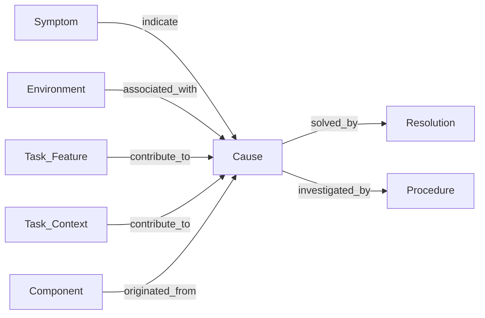
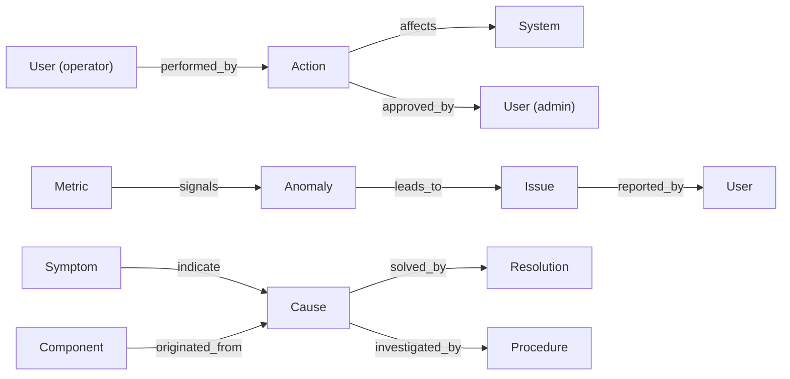

The knowledge graph schema used by the incident-analysis pipeline. Node and relationship
types are defined in `bamboo/models/graph_element.py` (`NodeType` and `RelationType`).

The [Code Map](/bamboo/architecture/code-map/), machine-derived from source, is not
stored here: it is kept as a dump, one per source version. See
[Two bodies of knowledge](#two-bodies-of-knowledge) below.

## Core schema

This is the subset the incident-analysis pipeline actually extracts and queries.



### Core node types

| Node | Description |
|------|-------------|
| `Symptom` | Observed failure class (e.g. error message category) |
| `Cause` | Root cause of the incident |
| `Resolution` | Solution or fix applied |
| `Procedure` | Investigation strategy for a cause type, extracted from email threads |
| `Environment` | External factor contributing to the cause (e.g. OS, runtime version) |
| `Task_Feature` | Discrete task *configuration* attribute stored as `attribute=value` (e.g. `coreCount=8`) |
| `Component` | System component where the cause originated |
| `Task_Context` | Free-form prose context — stored in vector database only, not in graph |

### Core relationships

| Relationship | From → To | Description |
|---|---|---|
| `indicate` | Symptom → Cause | Symptom points to a root cause |
| `solved_by` | Cause → Resolution | Cause is resolved by a resolution |
| `investigated_by` | Cause → Procedure | Cause is investigated by a procedure |
| `contribute_to` | Task_Feature / Task_Context → Cause | Feature or context contributes to a cause |
| `originated_from` | Component → Cause | Cause originated in a component |
| `associated_with` | Environment → Cause | Cause associated with an external factor |

### Log-level distinction

Task-level logs from orchestration services (JEDI, Harvester, …) are accepted as `task_logs`,
keyed by source name. Each source is filtered and analysed by the LLM independently; every
extracted node is tagged with `log_source` in its metadata.

## Two bodies of knowledge

Bamboo holds two bodies of knowledge with opposite lifecycles, and they are kept in
different places.

| | Incident graph | Code Map |
|---|---|---|
| Where it comes from | LLM extraction from incidents, human-validated | Machine-derived from source by `build-map` |
| If you lose it | Irreplaceable | Rebuild it in a minute |
| Where it is kept | This Neo4j database | A dump per source version (`build-map --dump`) |
| Labels | `Symptom`, `Cause`, `Resolution`, … | `Subject`, `Entity`, `JunctionPoint`, `FilterStage`, `LoopCut`, `Boundary`, `ValueEnum`, `Gloss`, `LogSite`, `ReadSite`, `FunctionPrints`, `Reach` |

The Code Map was once stored in this database under its own labels. It left because
nothing about reading it needs a database. Every reading is a lookup by name, never an
edge: `JunctionPoint.subject` holds a `Subject.name`, and a `passthrough(...)` chain
lives inside `branches`. The reader (`CodeMap`) takes the dump's own nodes. And each
case has to be read against the map of the source version that wrote its log, while
the database held one build at a time. No backend method stores or reads a map now;
`clear_all()` drops everything the database holds.

The two would join at `Component`: an incident's `Component` node and the Code Map's
junctions describe the same subsystem from opposite directions, which is what
`implemented_by` is for. Nothing produces that join today. See the
[Code Map overview](/bamboo/architecture/code-map/) for what the Code Map node kinds mean.

## Extended catalogue

The model defines a larger set of node and relationship types — **30 node types** and
**23 relationship types** in total — available for future extraction strategies beyond the core
incident-analysis pipeline.

### Node types (30)

```
- Symptom: Symptom messages and failures
- Cause: Root causes of issues
- Resolution: Solutions and fixes
- Environment: External factors
- Task_Feature: Task configuration attributes (discrete or bucketed)
- Task_Context: Free-form prose fields stored in vector DB for semantic search
- Procedure: Investigation strategy for a cause type, extracted from email threads
- Component: System origin of causes
- Metric: System metrics and KPIs
- Anomaly: Detected anomalies
- Issue: System issues
- System: Systems and services
- Pattern: Operational patterns
- Optimization: Optimization opportunities
- Event: System events
- Action: Actions (automated/manual)
- Dependency: System dependencies
- User: Users (operators, engineers, admins)

Code Map types (machine-derived from source, separate namespace):
- Subject: An attribute worth asking "why is it this value?" about
- Entity: A kind of row, with the functions that read it and the functions that write it
- JunctionPoint: A place the code settles a subject's value, with one branch per outcome
- FilterStage: One reason a candidate was dropped on the way to a selection
- LoopCut: A guard inside a loop that drops the candidate and says why in prose
- Boundary: Where causation crosses into a system this map does not cover
- ValueEnum: One `NAME = value` constant the code reads as a code (compared with, stored in a field, listed), so a code seen in a record can be decoded
- Gloss: A reading of one function, with the exact text that reading was given
- LogSite: Where one function's diagnostics land, for a function that decides nothing
- ReadSite: One statement that asks the database for rows by a value
- FunctionPrints: Every line one function can print, for every function in the corpus that prints
- Reach: Where one function can go on to -- its calls, its database calls and the calls it cannot follow -- for every function in the corpus
```

### Relationship types (23)

```
Core Relationships:
- indicate: Symptom indicates Cause
- associated_with: Environment associated with Cause
- contribute_to: Task_Feature / Task_Context contributes to Cause
- originated_from: Component originated_from Cause
- solved_by: Cause solved by Resolution
- investigated_by: Cause investigated_by Procedure

System Relationships:
- signals: Metric signals Anomaly
- leads_to: Anomaly leads to Issue
- has_component: System has Component
- depends_on: Component depends on Dependency
- suggests: Pattern suggests Optimization
- improves: Optimization improves Performance
- triggers: Event triggers Action
- affects: Action affects System

User Relationships:
- performed_by: Action performed by User
- reported_by: Issue reported by User
- assigned_to: Task assigned to User
- approved_by: Action approved by User

Code Map Relationships:
- writes: JunctionPoint writes Subject
- reads: JunctionPoint reads Subject (an input to its path condition)
- bounded_by: JunctionPoint bounded_by Boundary
- upstream_of: JunctionPoint upstream_of JunctionPoint (the backward walk's edge)
- implemented_by: Component implemented_by JunctionPoint (the join to the incident graph)
```

### Extended graph example


